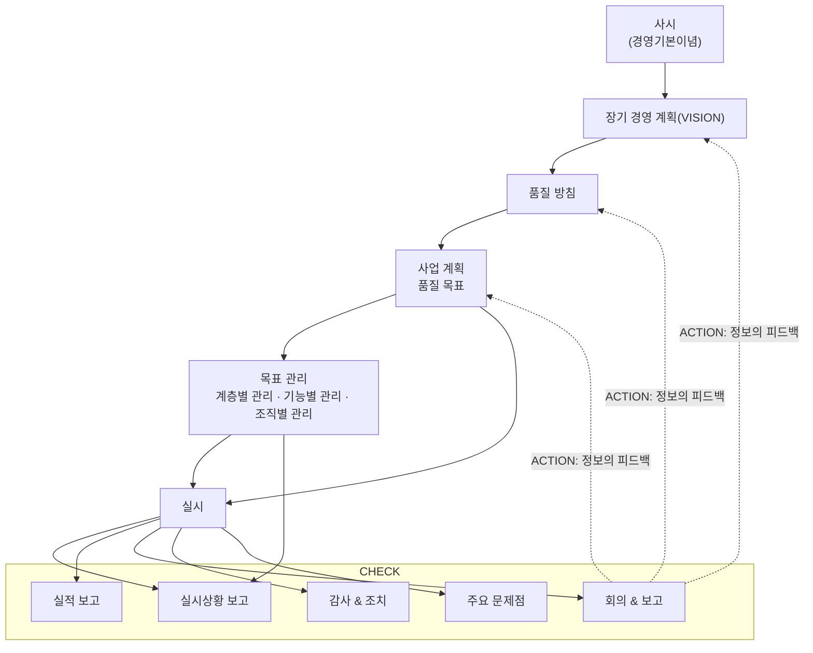

# 전립선 MRI AI 소프트웨어(SaMD) 디지털의료기기 GMP·ISO 13485 심사 준비 정리

> 이 문서는 2026년 10월 기준으로 정리한 자료입니다. 고시와 가이드라인 원문은 식약처 의료기기안전국과 국가법령정보센터에서 최신본을 다시 확인해야 합니다.

---

## 1. 법적 근거 및 적용 규정

전립선 MRI AI 소프트웨어는 독립형 AI 소프트웨어입니다. 따라서 「의료기기법」이 아니라 「디지털의료제품법」(2025.1.24 시행) 체계의 **디지털의료기기**로 GMP 심사를 받습니다. 심사 기준은 「디지털의료기기 제조 및 품질관리 기준」으로, ISO 13485:2016 구조에 소프트웨어·AI 특성을 더한 것입니다.

| 구분 | 규정 | 이번 심사에서의 의미 |
| --- | --- | --- |
| 법률 | 「디지털의료제품법」, 같은 법 시행령·시행규칙 | 디지털의료기기 제조업 허가, 품목 허가·인증, GMP 적합판정의 근거 |
| 고시 | 「디지털의료기기 제조 및 품질관리 기준」(식약처 고시) | 실제 심사 기준. 기존 의료기기 GMP에 소프트웨어 특성과 AI 생명주기(학습·평가데이터 관리)를 반영 |
| 고시 | 「디지털의료기기 전자적 침해행위 보안지침」 | 물리적(시설·장비)·기술적(데이터·AI/ML·개인정보) 보안 준수사항 |
| 고시 | 「디지털의료제품 허가·인증·신고·심사 및 평가 등에 관한 규정」(2026.7.27 개정) | 허가 시 임상시험자료 제출·면제 기준, 우수관리체계 특례 범위(2등급 → 등급 미지정 대상까지 확대) |
| 가이드라인 | 디지털의료기기 GMP 가이드라인 | 고시 조문별 해석, SaMD 설계·개발·유지보수 절차서 예시, ISO·IEC 연계 |
| 가이드라인 | 전자적 침해행위 보안지침 가이드라인 | IMDRF 사이버보안 지침과의 부합성, 인허가·GMP 심사용 체크리스트 |
| 질의·응답집 | 디지털의료기기 GMP 질의·응답집(2026.9.16 발간) | 신청서 작성, 심사 구분별 요건, AI 모델 성능 검증·편향성 관리 사례 |
| 국제표준 | ISO 13485:2016, ISO 14971:2019, IEC 62304, IEC 62366-1, IEC 81001-5-1 | 품질경영, 위험관리, SW 생명주기, 사용적합성, 보안의 실무 기준 |

**먼저 확정할 사항:** 품목 등급(2등급/3등급)과 품목 분류명. 등급에 따라 허가·인증 경로와 GMP 심사 방식(서류 또는 현장)이 달라집니다.

---

## 2. 심사 개요

신규 업체는 **최초심사**로 디지털의료기기 GMP 적합판정서를 받아야 합니다. 신청은 인증업무 대행기관인 **한국의료기기안전정보원(NIDS)**에 합니다.

| 항목 | 내용 |
| --- | --- |
| 심사 구분 | 최초심사, 추가심사(품목군 추가), 변경심사, 정기심사 |
| 최초심사 요건 | 최소 1개 제조단위 이상의 품질관리 실적 보유. SW는 릴리스된 버전 1개의 설계·검증·출하 기록 일체 |
| 현장조사 일정 | 희망일을 조사일 20일 전까지 확정 신청 |
| 품질책임자 | 디지털의료기기는 소프트웨어 기술자, 보건의료정보관리사 등도 품질책임자로 지정 가능 |
| 기존 의료기기 GMP 보유 시 | 유효기간 동안은 디지털 GMP로 간주. 정기심사에서 디지털 GMP로 전환해야 계속 판매 가능 |
| 유효기간 | 적합판정 후 3년, 정기심사로 갱신 (근거 조문 재확인 필요) |

허가와 GMP는 함께 진행됩니다. 품목 허가·인증 신청 전에 GMP 적합판정을 받거나 동시에 진행해야 출시가 늦어지지 않습니다.

---

## 3. 단계별 준비 로드맵

문서를 먼저 다 만들고 나중에 기록을 채우면 심사에서 바로 드러납니다. 절차서를 확정한 뒤 실제 릴리스 1건을 그 절차대로 진행해 기록을 남기는 것이 핵심입니다.

1. **현황 진단(Gap 분석)**
    - 디지털의료기기 GMP 고시·가이드라인 조항별로 현재 문서와 기록을 대조
    - 품목 등급·분류명, 사용 목적(Intended Use) 확정
2. **조직·책임 정비**
    - 대표, 품질책임자, 개발책임자, 관리책임자 지정 및 직무기술서 작성
    - 연구개발과 품질 업무의 독립성 확보. 소규모 조직은 겸직 범위와 견제 장치를 명시
3. **품질문서 작성**
    - 품질매뉴얼 → 절차서 → 양식·지침서 순서로 작성
    - 문서번호 체계, 개정 이력, 승인 서명 체계 통일
4. **교육 및 시행**
    - 전 직원 GMP·절차서 교육 실시, 교육기록 확보
5. **릴리스 1건 실적 확보**
    - 설계입력부터 검증, 유효성확인, 출하승인까지 한 버전을 절차대로 수행
    - 위험관리파일, SW 생명주기 산출물, AI 데이터 기록 완비
6. **내부심사 및 경영검토**
    - 독립된 심사원이 전 프로세스를 내부심사, 부적합은 시정조치 완료
    - 경영검토 회의록 1회 이상 확보
7. **심사 신청 및 수검**
    - 한국의료기기안전정보원에 신청, 현장조사 희망일 20일 전 확정
    - 모의심사로 담당자별 질의응답 연습
8. **지적사항 보완 및 적합판정**

---

## 4. 품질문서 체계 (ISO 13485 조항 대응)

품질매뉴얼 1부와 절차서 약 20종이 기본 골격입니다. SaMD는 생산·설치 공정이 없으므로 해당 조항은 "빌드·배포·설치"로 바꿔 쓰고, 적용 제외 조항은 품질매뉴얼에 사유를 적습니다.

| ISO 13485 조항 | 문서 | SaMD에서 챙길 점 |
| --- | --- | --- |
| 4.1, 4.2 | 품질매뉴얼, 문서관리 절차서, 기록관리 절차서 | 전자문서·전자서명 사용 시 접근권한·변경이력 관리 |
| 4.1.6 | 소프트웨어 유효성확인 절차서 | QMS에 쓰는 도구(Git, 이슈트래커, CI, 라벨링 툴) 유효성확인 |
| 5 | 경영책임 절차서(품질방침·목표, 경영검토) | 품질목표에 버그 재발률, 배포 실패율 등 SW 지표 반영 |
| 6.2 | 교육훈련 절차서 | 개발자 대상 IEC 62304·보안 교육 기록 |
| 6.3, 6.4 | 기반시설·작업환경 절차서 | 개발·운영 서버, 클라우드, 백업, 출입·접근통제 |
| 7.1 | 위험관리 절차서 (ISO 14971) | 위해요인에 오진(위음성·위양성), 데이터 편향, 사이버보안 포함 |
| 7.2 | 고객관련 프로세스 절차서 | 병원 계약·요구사항 검토, PACS 연동 조건 |
| 7.3 | 설계 및 개발 절차서 | IEC 62304 생명주기, AI 모델 개발·학습·평가 단계 포함 |
| 7.4 | 구매관리 절차서 | 클라우드, 오픈소스(SOUP), 데이터 제공기관을 공급자로 관리 |
| 7.5 | 빌드·릴리스·설치 절차서, 식별 및 추적성 절차서 | 버전 번호 체계, UDI, 배포 패키지 무결성(해시) |
| 7.5.6 | 공정 유효성확인 절차서 | 빌드·배포 파이프라인 유효성확인 |
| 7.6 | 모니터링·측정장비 관리 절차서 | 대부분 적용 제외. 성능 측정용 기준 데이터셋 관리로 대체 가능 |
| 8.2.1, 8.2.2 | 피드백·불만처리 절차서 | 사용자 오류 신고, 오진 사례 접수 |
| 8.2.3 | 부작용 보고 절차서 | 식약처 보고 기한 준수 |
| 8.2.4 | 내부심사 절차서 | 심사원 독립성, 연 1회 이상 |
| 8.3 | 부적합품 관리 절차서 | 출시 후 발견된 결함(버그) 처리, 회수 판단 |
| 8.4 | 데이터분석 절차서 | 시판 후 성능 모니터링 지표 |
| 8.5 | 시정 및 예방조치(CAPA) 절차서 | 원인분석과 효과성 확인 기록 |
| (디지털 GMP) | 전자적 침해행위 보안관리 절차서 | 취약점 관리, 보안 업데이트 배포·통보 |
| (디지털 GMP) | AI 데이터 관리 절차서 | 학습·검증·시험 데이터 분리, 출처·라벨링 기록 |
| (디지털 GMP) | 변경관리 절차서 | 모델 재학습·버전 변경의 허가 영향 판단 |

---

## 5. SaMD·AI 특화 요구사항

디지털 GMP 심사에서는 기존 제조 중심 항목 외에 SW 개발 생명주기, 변경이력, 데이터 추적성, 사이버보안을 집중적으로 봅니다.

### 5.1 SW 생명주기 (IEC 62304)

- SW 안전등급(A/B/C) 지정과 근거. 위음성으로 암을 놓칠 수 있다면 B 또는 C 등급 검토
- 개발계획서 → 요구사항명세 → 아키텍처설계 → 상세설계 → 단위·통합·시스템 시험 → 릴리스
- SOUP 목록: PyTorch, nnU-Net, MONAI, DICOM 라이브러리 등의 버전, 용도, 알려진 이상 검토
- 형상관리: Git 브랜치 전략, 코드리뷰 기록, 빌드 재현성
- 결함관리: 이슈트래커 기록과 미해결 결함의 위험 평가

### 5.2 AI 모델 생명주기

- **데이터 관리:** 학습·튜닝·시험 데이터의 출처(기관, 장비 제조사, 자장 세기, 촬영 프로토콜), IRB·가명처리 근거, 환자 단위 분리 증빙
- **라벨링:** 판독자 자격, 판독 기준(PI-RADS 버전), 판독자 간 일치도, 병리 결과와의 대조 방법
- **성능 검증:** 사전에 정한 합격 기준(민감도, 특이도, AUC 등), 외부 데이터셋 검증, 하위군(연령, PSA, 장비, 병원) 분석
- **편향성 관리:** 데이터 분포 보고, 성능이 떨어지는 하위군에 대한 위험 통제
- **모델 버전관리:** 가중치 파일 해시, 학습 코드·하이퍼파라미터·데이터 스냅샷의 연결

### 5.3 사이버보안

- 위협 모델링과 보안 위험평가 (IEC 81001-5-1 참고)
- SBOM(소프트웨어 구성요소 목록)과 취약점 모니터링
- 인증·권한, 전송·저장 암호화, 감사로그
- 보안 업데이트를 설치장소(병원)에 지속적으로 통보하는 절차

### 5.4 변경관리

- 모델 재학습, 임계값 조정, 전처리 변경이 허가사항 변경에 해당하는지 판단하는 기준표
- AI 제품은 시판 전 변경관리계획(PCCP)을 제출하면 계획 범위 안의 변경을 신속하게 처리할 수 있으므로 허가 전략과 함께 검토

### 5.5 사용적합성 (IEC 62366-1)

- 판독의 사용 시나리오, 사용 오류 분석, 총괄평가(Summative) 기록
- 결과 화면의 오해 소지 점검 (보조 결과임을 명확히 표시)

---

## 6. 기술문서·기록 체크리스트

심사원은 절차서보다 **기록**을 봅니다. 아래 항목이 릴리스 1건을 기준으로 모두 연결되어 있어야 합니다.

**조직·경영**

- [ ] 조직도, 직무기술서, 품질책임자 지정서
- [ ] 품질방침·품질목표와 달성도 측정 기록
- [ ] 경영검토 회의록
- [ ] 교육계획과 개인별 교육기록

**설계 및 개발**

- [ ] 설계개발계획서, 사용 목적·사용자·사용 환경 정의
- [ ] SW 요구사항명세서와 추적성 매트릭스(요구사항 ↔ 설계 ↔ 시험 ↔ 위험통제)
- [ ] 아키텍처·상세설계서, SOUP 목록
- [ ] 단위·통합·시스템 시험 계획서와 결과보고서
- [ ] 단계별 설계검토 회의록
- [ ] 설계검증 보고서, 설계유효성확인(임상적 성능) 보고서
- [ ] 설계이관(릴리스) 기록, 릴리스 노트, 알려진 잔여 결함 목록

**AI 데이터**

- [ ] 데이터 관리계획서, 데이터셋 명세(출처, 기간, 장비, 분포)
- [ ] IRB 승인서, 가명처리 기록
- [ ] 라벨링 지침, 판독자 자격·일치도 기록
- [ ] 학습·검증·시험 분리 증빙, 모델 버전·해시 기록
- [ ] 성능평가 보고서(하위군 분석 포함)

**위험관리·보안**

- [ ] 위험관리계획서, 위험분석·평가표, 위험관리보고서
- [ ] 사이버보안 위험평가, SBOM, 보안 시험(취약점 점검) 결과
- [ ] 사용적합성 평가 보고서

**출하·시판 후**

- [ ] 빌드·배포 기록, 출하승인서, 설치·검수 기록
- [ ] 사용자 설명서(전자적으로 제공할 경우 버전 관리)
- [ ] 공급자 평가 기록(클라우드, 데이터 제공기관)
- [ ] 불만·CAPA·내부심사 기록(최소 1회차)

---

## 7. 자주 지적되는 사항과 대응

소프트웨어 업체가 첫 GMP 심사에서 흔히 받는 지적은 "절차서는 있는데 기록이 그 절차와 다르다"는 유형입니다. 아래는 일반적인 경향이며, 식약처 질의·응답집의 심사 사례로 보완하는 것이 좋습니다.

| 지적 유형 | 예시 | 대응 |
| --- | --- | --- |
| 추적성 단절 | 요구사항에 대응하는 시험이 없거나, 위험통제가 시험으로 검증되지 않음 | 추적성 매트릭스를 릴리스 전 필수 산출물로 지정 |
| 기록 소급 작성 | 설계검토 회의록 날짜가 릴리스 이후 | 회의 당일 서명, Git 커밋 이력과 날짜 일치 |
| 데이터 분리 불명확 | 같은 환자가 학습셋과 시험셋에 중복 | 환자 ID 단위 분리 스크립트와 결과 로그 보관 |
| 변경관리 누락 | 모델 재학습 후 허가 영향 판단 없이 배포 | 변경요청서에 허가 영향 판단란 필수화 |
| SOUP 관리 미흡 | 오픈소스 버전·라이선스·알려진 결함 미검토 | 릴리스마다 SOUP 목록 갱신 |
| 공급자 관리 누락 | 클라우드, 데이터 제공 병원을 공급자로 평가하지 않음 | 핵심 공급자 지정, 연 1회 평가 |
| 내부심사 독립성 | 개발책임자가 자기 업무를 직접 심사 | 외부 심사원 위탁 또는 교차 심사 |
| 보안 업데이트 통보 | 패치 배포 후 병원 통보 기록 없음 | 배포 시 통보 양식과 수신 확인 기록 |

---

## 8. ISO 13485 정기심사 준비 시 먼저 고려할 사항

먼저 어떤 심사인지 구분해야 준비 범위가 정해집니다.

- **ISO 13485 인증(인증기관):** 사후심사는 매년, 갱신심사는 3년마다
- **식약처 디지털의료기기 GMP 정기심사:** 적합판정 유효기간(3년) 만료 전

두 심사는 기준이 비슷해도 심사기관, 주기, 중점이 다릅니다. 둘 다 받는다면 일정을 맞춰 한 번에 준비하는 것이 효율적입니다. 어느 쪽이든 아래 순서로 점검합니다.

1. **지난 심사 지적사항 종결 여부**
   가장 먼저 확인하는 항목입니다. 시정조치를 했는지보다 **효과성 확인 기록**까지 남았는지를 봅니다. 같은 지적이 반복되면 중부적합으로 올라갈 수 있습니다.
2. **직전 심사 이후의 변경사항**
   조직·인원(특히 품질책임자), 사업장·서버·클라우드, 제품 버전, 공급자, 적용 규정의 변화를 정리합니다. 디지털의료제품법 시행 후 기존 GMP에서 **디지털 GMP로 전환**하는 첫 정기심사라면 SW 생명주기, 데이터 추적성, 사이버보안 같은 신규 항목을 따로 대비합니다.
3. **QMS가 실제로 운영된 기록**
   - 내부심사 (전 프로세스, 독립된 심사원)
   - 경영검토 회의록 (입력·출력 항목을 모두 다뤘는지)
   - 품질목표 달성도 측정
   - 교육기록, 공급자 재평가
4. **출시 후 활동**
   불만·오류 신고 처리, 부작용 보고 여부, 시판 후 성능 모니터링, 보안 업데이트를 병원에 통보한 기록, CAPA를 확인합니다.
5. **설계변경과 소프트웨어 릴리스 기록**
   배포한 버전마다 변경요청 → 허가 영향 판단 → 위험관리 갱신 → 검증 → 릴리스 승인이 이어지는지 확인합니다. AI 모델을 재학습했다면 데이터·모델 버전 기록과 성능 재검증 결과가 함께 있어야 합니다.
6. **위험관리파일 최신화**
   출시 후 수집한 정보(불만, 결함, 새로 알려진 보안 취약점)가 위험관리파일에 반영됐는지 봅니다. 출시 시점 그대로 멈춰 있는 경우가 흔한 지적사항입니다.

실무적으로는 지난 심사보고서와 그 이후의 변경 목록을 나란히 놓고 시작하는 것이 가장 빠릅니다.

---

## 9. 품질매뉴얼 개정 이력 문구

**기존(신규 제정) 문구 형식**

> ISO 13485 : 2016 의료기기 품질경영시스템과 의료기기 제조 및 품질관리기준(GMP)을 당사의 관리 체계에 수용하기 위하여 신규 제정

**참고 문구**

> 식약처고시 『의료기기 제조 및 품질관리 기준』, ISO 13485:2016 및 CE MDD 2007/47/EC 시스템 도입을 위하여 당사의 현장에 맞도록 전면개정

**작성 조건:** 기존 문구 형식을 따를 것, CE MDD 2007/47/EC 내용은 제외할 것

**완성 문구 (전면 개정)**

> 식약처 고시 『의료기기 제조 및 품질관리 기준』과 ISO 13485:2016 의료기기 품질경영시스템을 당사의 현장에 맞도록 수용하기 위하여 전면 개정

**디지털 GMP로 전환하는 개정일 경우**

> 식약처 고시 『디지털의료기기 제조 및 품질관리 기준』과 ISO 13485:2016 의료기기 품질경영시스템을 당사의 현장에 맞도록 수용하기 위하여 전면 개정

**표기 참고:** 문서 안에서 ISO 표기를 통일합니다. 일반적인 표기는 "ISO 13485:2016"(콜론 앞뒤 띄어쓰기 없음)입니다.

---

## 10. 경영관리 체계도 (PDCA)

품질매뉴얼의 경영관리 체계도입니다. 사시(경영기본이념)에서 시작해 PLAN → DO → CHECK → ACTION(정보의 피드백) 순으로 순환합니다.

### 구성

- **출발점:** 사시(경영기본이념)
- **PLAN**
    - 장기 경영 계획(VISION)
    - 품질 방침
    - 사업 계획 / 품질 목표
- **DO**
    - 목표 관리: 계층별 관리, 기능별 관리, 조직별 관리
    - 실시
- **CHECK**
    - 실시상황 보고
    - 실적 보고
    - 회의 & 보고
    - 감사 & 조치
    - 주요 문제점
- **ACTION (정보의 피드백)**
    - "회의 & 보고"의 결과를 장기 경영 계획(VISION), 품질 방침, 사업 계획·품질 목표로 다시 반영

### 흐름

1. 사시 → 장기 경영 계획(VISION) → 품질 방침 → 사업 계획·품질 목표 → 목표 관리 → CHECK 단계 (위에서 아래로 진행)
2. 사업 계획·품질 목표 → 실시
3. 목표 관리(계층별·기능별·조직별 관리) → 실시
4. 실시 → 실시상황 보고, 실적 보고, 회의 & 보고, 감사 & 조치, 주요 문제점 (CHECK 각 항목으로 보고)
5. 회의 & 보고 → 정보의 피드백 → 장기 경영 계획(VISION), 품질 방침, 사업 계획·품질 목표 (ACTION)

| PDCA 단계 | 해당 항목 |
| --- | --- |
| PLAN | 장기 경영 계획(VISION), 품질 방침, 사업 계획·품질 목표 |
| DO | 목표 관리(계층별·기능별·조직별 관리), 실시 |
| CHECK | 실시상황 보고, 실적 보고, 회의 & 보고, 감사 & 조치, 주요 문제점 |
| ACTION | 정보의 피드백 (회의 & 보고 → PLAN 단계 각 항목) |

---

## 11. 설계입력 항목 검토 (ISO 13485:2016 7.3.3 대비)

### 11.1 기준 목록 (기존 GMP 설계입력 항목)

1. 의도된 사용에 필요한 기능, 성능 및 사용적합성, 안전 요구사항
2. 적용되는 법적 요구사항(적용되는 규격 및 관련 설계요구사항)
3. 해당하는 경우, 이전의 유사한 설계로부터 도출된 정보
4. 설계 및 개발에 필수적인 기타 요구사항
5. 위험성평가 및 산정과정의 출력(관리 조치의 필요성 등)
6. 요구사항을 만족하기 위한 부품의 사양, 재질, 공정의 사용과 선택
7. 지역별 안전성 요구사항(MDD Annex II, 제품규격, 관련 고시나 규정 등)
8. 기타

### 11.2 현재 소프트웨어 설계입력 목록

- (1) (확인하지 못함)
- (2) 규격의 사용과 선택
- (3) 의도된 사용에 필요한 기능, 성능, 사용적합성, 역량 및 안전 요구사항 (물리적 특성(코딩언어, 플랫폼, 운영체제), 실행환경(하드웨어, 메모리), 호환성 등)
- (4) 보안 요구사항 (정보 누설, 인증, 권한부여, 감사추적, 통신, 악성 소프트웨어 보호 등)
- (5) 소프트웨어 의료기기 사용자 인터페이스 요구사항 (사람-장비 간 상호작용 등)
- (6) 운영 및 유지보수 시 배포되는 소프트웨어 설치 및 허용 요구사항
- (7) 신뢰성, 안정성에 대한 예상성능 및 분석
- (8) 새로운 기술, 공정의 평가
- (9) 안전성 요구사항 (제품규격, 관련 고시나 규정 등)
- (10) 사용적합성(Usability) 및 안전 요구사항

### 11.3 대조 결과

| 기준 항목 | 현재 목록 대응 | 판단 |
| --- | --- | --- |
| 1) 기능, 성능, 사용적합성, 안전 요구사항 | (3), (10) | 반영됨 |
| 2) 법적 요구사항(규격, 설계요구사항) | (2), (9) | 반영됨. "법적 요구사항"이라는 표현은 없음 |
| 3) 이전 유사 설계에서 도출된 정보 | 없음 | **추가 필요** |
| 4) 설계·개발에 필수적인 기타 요구사항 | 없음 ((8)은 성격이 다름) | **추가 필요** |
| 5) 위험성 평가 결과(관리 조치의 필요성 등) | 없음 ((7)은 신뢰성 분석이며 위험관리가 아님) | **추가 필요, 가장 중요** |
| 6) 부품 사양, 재질, 공정의 사용과 선택 | (2)에서 일부만 반영 | 필수 아님. 소프트웨어에 맞게 보완 권장 |
| 7) 지역별 안전성 요구사항 | (9) | 반영됨. 수출 국가가 있으면 "국가별" 문구 보완 |
| 8) 기타 | 없음 | 4)와 같은 내용이므로 생략 가능 |

### 11.4 결론

- **필수 추가 항목은 3, 4, 5번 세 가지입니다.** 이 세 항목은 ISO 13485:2016 7.3.3에서 요구하는 설계입력입니다.
    - 7.3.3 요구 항목: a) 기능, 성능, 사용적합성, 안전 요구사항 / b) 적용되는 규제 요구사항과 규격 / c) 위험관리 결과 / d) 해당하는 경우 이전 유사 설계에서 얻은 정보 / e) 제품과 프로세스의 설계·개발에 필수적인 기타 요구사항
- **6번:** 하드웨어 제조를 기준으로 만든 항목이라 필수는 아닙니다. 다만 소프트웨어에서는 SOUP·오픈소스 선택에 해당하고 심사원이 자주 묻는 부분이므로 넣는 것을 권장합니다.
- **8번:** 4번과 같은 내용이므로 생략해도 됩니다.
- **1, 2, 7번:** 기존 (2), (3), (9), (10)에 이미 반영되어 있습니다.
- (1) 항목에 3·4·5번 내용이 이미 있다면 해당 항목은 빼도 됩니다.

### 11.5 추가 문안 (기존 번호 다음에 이어서 넣는 경우)

- (11) 위험관리 결과에 따른 요구사항 (위험분석·평가 결과 도출된 위험통제 조치 등)
- (12) 해당하는 경우, 이전의 유사한 설계로부터 도출된 정보 (이전 버전의 결함, 고객 불만, 시판 후 자료 등)
- (13) 소프트웨어 구성요소의 사양과 선택 (SOUP·오픈소스, 개발 도구, 라이브러리 버전 등) — 권장
- (14) 그 밖에 설계 및 개발에 필수적인 요구사항
- (15) 인공지능 학습·검증·시험 데이터 요구사항 (데이터 출처, 규모, 분포, 라벨링 기준 등) — AI 제품 권장

### 11.6 함께 다듬을 점

- **(3)과 (10)이 겹칩니다.** (3)의 "성능, 사용적합성, 안전"이 (10)과 중복됩니다. (3)은 기능·성능·호환성 위주로 두고, 사용적합성과 안전은 (10)으로 모읍니다.
- **(9)에 법적 요구사항을 명시합니다.** 예: "안전성 및 법적 요구사항 (제품규격, 관련 법령·고시·규정 등)"
- **AI 제품은 데이터 요구사항을 넣습니다.** 디지털의료기기 GMP는 학습·평가데이터 관리를 따로 봅니다.

---

## 12. ISO 14971 최신 규격

- **최신판: ISO 14971:2019 (제3판)**
    - 2019년 12월 발행
    - 2025년 3월 정기 검토에서 개정 없이 유지하기로 확정 (stage 90.93)
    - 진행 중인 개정이나 추가 개정판(Amendment) 없음
    - 5년 주기로 검토하므로 다음 검토는 2030년 무렵
- **문서 표기:** GMP·ISO 13485 심사 문서에는 "ISO 14971:2019"로 적습니다.

### 관련 문서

| 문서 | 내용 | 활용 |
| --- | --- | --- |
| ISO/TR 24971:2020 | ISO 14971 적용 지침서. 2019판 본문에서 빠진 부속서 일부(위험 분석 기법 등)가 옮겨짐 | 위험관리 절차서의 참고 문헌으로 함께 기재 |
| EN ISO 14971:2019/A11:2021 | 유럽(CE)용 판. 국제 규격 본문은 같고 유럽 규정과의 관계(부속서 Z)만 추가 | 유럽 수출 시에만 해당 |
| AAMI TIR34971:2023 | AI·머신러닝 의료기기에 ISO 14971을 적용하는 지침 | 데이터 편향, 성능 저하를 위해요인으로 다룰 때 근거 자료 |

### 2019판에서 강화된 내용 (절차서 반영 필요)

- "편익(benefit)" 정의 신설과 편익-위험 분석
- 생산 및 생산 후 정보 수집·검토
- 전체 잔여위험 평가

절차서에 이전 판(ISO 14971:2007, EN ISO 14971:2012)이 적혀 있다면 2019판으로 바꿔야 합니다.

---

## 13. 의료기기 설치 절차의 "와이어링(배선)"

"와이어링(wiring)"은 의료기기 설치 절차에서 **배선 작업**을 뜻합니다. 장비를 전원, 접지, 다른 장비와 케이블로 연결하는 작업입니다. 한국어로는 "배선"이 가장 자연스럽습니다.

### 13.1 하드웨어 의료기기의 배선 항목

- 전원 배선: 정격 전압·주파수 확인, 전용 회로, 차단기
- 접지: 보호접지 연결, 접지 저항 확인 (IEC 60601-1 기준)
- 신호·통신 배선: 장비 간 케이블 연결, 커넥터 체결 상태
- 배선 후 점검: 절연, 누설전류, 동작 확인 기록

### 13.2 독립형 소프트웨어(SaMD)의 대체 항목

독립형 소프트웨어는 물리적 배선이 없습니다. 하드웨어용 양식을 쓰고 있다면 항목을 지우지 말고 **"시스템 연동 및 네트워크 설정"**으로 바꿉니다.

**와이어링 → 시스템 연동 및 네트워크 설정**

- PACS·영상장비와의 DICOM 연동 설정 (AE Title, IP, 포트)
- 병원 네트워크·방화벽 허용 설정, 통신 암호화 적용
- 서버 또는 클라우드 설치 환경 확인 (운영체제, GPU, 저장공간)
- 연동 시험: 시험 영상 전송·수신, 분석 결과 반환 확인
- 설치 및 검수 기록 작성, 병원 담당자 확인 서명

전원 공급 장치나 전용 서버 같은 하드웨어를 함께 납품한다면, 그 장비에 한해 기존 배선 항목을 남겨 둡니다.

---

## 14. 참고자료

- [ISO 14971:2019 – ISO 공식 페이지](https://www.iso.org/standard/72704.html)
- [Revision of ISO 14971 and ISO/TR 24971 – ISO/TC 210](https://committee.iso.org/sites/tc210/home/news/content-left-area/news-and-updates/revision-of-iso-14971-and-isotr.html)
- [ISO 14971:2019 and current state of risk management – Emergo by UL](https://emergobyul.com/resources/iso-149712019-and-current-state-risk-management)
- [디지털의료기기 GMP 제도 질의·응답집 발간 안내 (KDI 경제정보센터, 2026.9.16)](https://eiec.kdi.re.kr/policy/materialView.do?num=286917)
- [식약처, 디지털의료기기 GMP·보안지침 가이드라인 제정 (노컷뉴스)](https://www.nocutnews.co.kr/news/6428073)
- [디지털의료기기 인허가 합리화, 우수관리체계 특례 확대 (데일리팜, 2026.7.28)](https://www.dailypharm.com/user/news/340892)
- [디지털의료제품법 시행, 신규 업체 GMP 신청 방법 (데일리팜, 2025.1.30)](https://dailypharm.com/user/news/8872)
- [디지털의료제품 하위 고시 8종 행정예고 (데일리팜, 2024.12.17)](https://dailypharm.com/user/news/10069)
- [자이메드 dGMP 갱신심사 사례 (한경 잡앤조이)](https://magazine.hankyung.com/job-joy/article/202512032241d)
