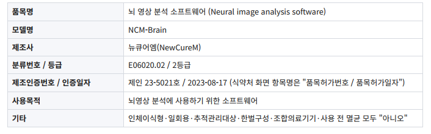
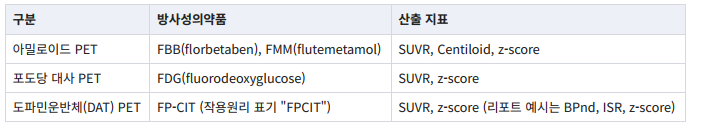
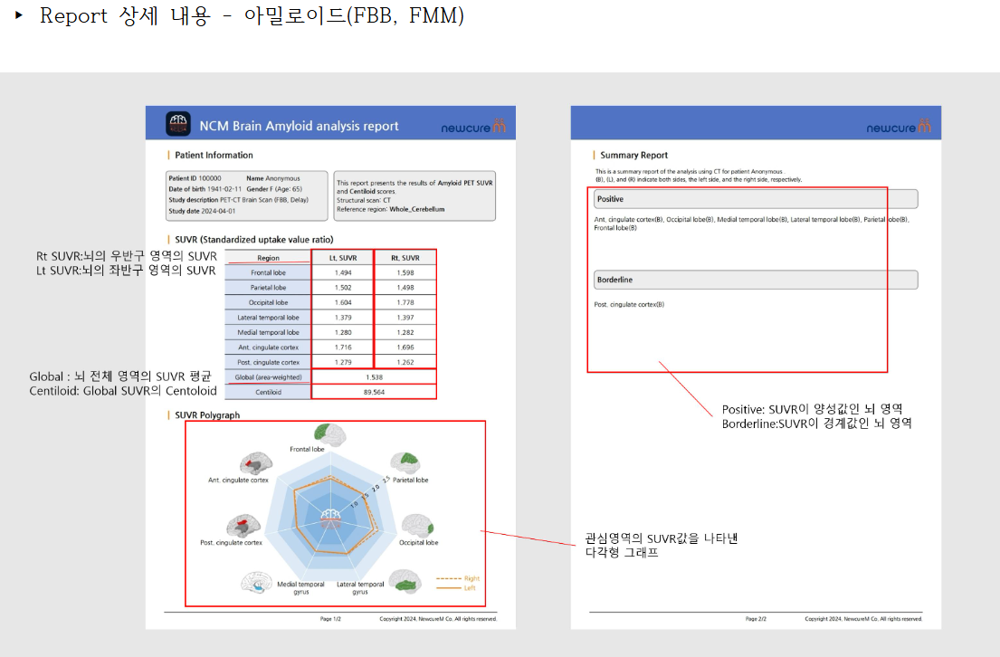
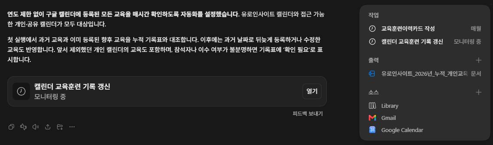
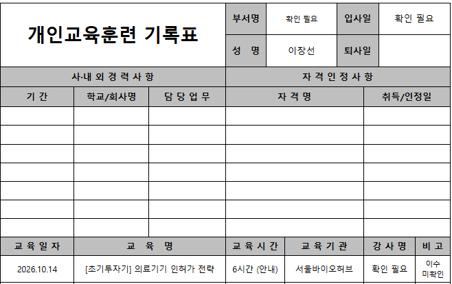

# 2026.11.18 연구노트 - 경쟁 제품 조사, 교육훈련 기록 자동화, ISO 13485 사후심사 준비

| 항목 | 내용 |
| --- | --- |
| 과제명 | [확인 필요] |
| 실험명 | ① 뉴큐어엠 NCM-Brain 등급·기능 조사 ② 교육훈련 기록 자동 작성 설정 ③ ISO 13485 사후심사 대비 품질절차서 점검 |
| 실험 기간 | [확인 필요] |
| 작성일 | 2026-11-18 |
| 작성자 | [확인 필요] |

## 1. 연구의 착상 및 목적

### 1.1 배경
- ① 자동 분할(segmentation)과 보고서(report) 생성 기능을 가진 의료기기 소프트웨어의 등급을 파악하기 위해, 유사 제품(뉴큐어엠 NCM-Brain)을 조사함. [확인 필요: 자사 제품 인허가와의 관련성]
- ② Google 캘린더의 교육 일정을 개인교육훈련 기록표에 자동으로 옮길 수 있는지 확인하고자 함. [확인 필요: 현재 작성 방식]
- ③ ISO 13485 인증 유지를 위한 사후심사에 대비해 품질절차서(UIT-QP) 31개의 수정·점검 현황을 관리함.

### 1.2 가설 및 목적
- 가설: 해당 없음 (조사·설정·현황 정리 업무).
- 목적:
  - ① 자동 분할 후 보고서 생성 기능을 가진 제품의 등급을 확인함.
  - ② Google 캘린더의 교육 일정을 읽어 교육훈련 양식에 자동으로 채울 수 있는지 시험함.
  - ③ 품질절차서별 완료·재확인 현황을 정리하고 남은 작업을 정함.

### 1.3 참고 자료 (출처)
- ① 식약처 의료기기 제품정보(NCM-Brain), NCM-Brain 「모양 및 구조-작용원리」·「모양 및 구조-외형」 자료, 뉴큐어엠 홈페이지 AI 제품 페이지(https://www.newcurem.com/product?tab=AI).
- ② 유로인사이트 Google 캘린더, 연결된 Gmail 계정의 교육 안내 메일, 개인교육훈련 기록표 양식.
- ③ 품질절차서 체크리스트(완료·재확인·메모), 11월 12일 회의자료.

## 2. 재료 및 장비

### 2.1 재료 (자료)
- ① NCM-Brain 품목 정보: 뇌 영상 분석 소프트웨어(Neural image analysis software), 분류번호 E06020.02, 2등급, 제조인증 제인 23-5021호(2023-08-17). 등급과 품목명은 법 개정 전 기준임.
- ① 분석 대상: 아밀로이드 PET(FBB, FMM), 포도당 대사 PET(FDG), 도파민운반체(DAT) PET(FP-CIT).

- ② 교육 일정·이수 자료: 유로인사이트 캘린더, 접근 가능한 개인·공유 캘린더, Gmail 교육 안내 메일.
- ③ 품질절차서 31개 (4항 2개, 5항 3개, 6항 3개, 7항 14개, 8항 9개).

### 2.2 실험 환경 (장비, 소프트웨어)

| 구분 | 항목 | 내용 |
| --- | --- | --- |
| ② 자동화 | 도구 | ChatGPT 작업 |
| | 연결 소스 | Library, Gmail, Google Calendar |
| | 출력 문서 | 유로인사이트_2026년_누적_개인교육… [확인 필요: 전체 파일명] |
| ③ 점검 | 도구 | 품질절차서 체크리스트(HTML, 완료·재확인·메모 기록) |

### 2.3 파일 저장 위치

| 구분 | 경로 |
| --- | --- |
| 원본 회의자료 | 1118 회의자료 PPT [확인 필요: 보관 위치] |
| 본 연구노트·그림 | `meeting/1118_연구노트/` (그림: `images/`) |
| ② 자동화 출력 문서 | ChatGPT 작업 출력 「유로인사이트_2026년_누적_개인교육…」 [확인 필요: 보관 위치] |
| ③ 체크리스트 | 품질절차서 체크리스트 HTML [확인 필요: 보관 위치] |

## 3. 실험방법

1. **뉴큐어엠 조사 (①)**
   - 식약처 제품정보에서 등급·품목명·분류번호를 확인함.
   - 작용원리·외형 자료와 홈페이지에서 분석 대상과 보고서 기능을 확인함.
2. **교육훈련 기록 자동화 설정 (②)**
   - 연도 제한 없이 Google 캘린더에 등록된 모든 교육을 매시간 확인하도록 설정함. 유로인사이트 캘린더와 접근 가능한 개인·공유 캘린더를 모두 대상으로 함.
   - 첫 실행에서 과거 교육과 이미 등록된 향후 교육을 누적 기록표와 대조하도록 함. 이후에는 과거 날짜로 늦게 등록하거나 수정한 교육도 반영하도록 함.
   - 참석자나 이수 여부가 불명확하면 기록표에 '확인 필요'로 표시하도록 함.
   - 작업은 두 가지로 나눔.

   | 작업 | 주기 |
   | --- | --- |
   | 교육훈련이력카드 작성 | 매월 |
   | 캘린더 교육훈련 기록 갱신 | '모니터링 중'으로 표시 |

3. **품질절차서 점검 (③)**
   - 체크리스트에서 절차서별 완료 여부, 재확인 표시, 메모를 확인해 항(4~8항)별로 집계함.

## 4. 실험 진행과정

| 일자 | 내용 |
| --- | --- |
| 2026-11-12 | 회의에서 품질절차서 진행 현황 보고 (31개 중 27개 완료) |
| [확인 필요] | 7항 미완료 절차서 4개(UIT-QP-701, 709, 712, 714) 완료, 재확인 대상 정리 |
| [확인 필요] | ChatGPT 작업으로 교육훈련 기록 자동화 설정 |
| 2026-11-18 | 회의에서 결과 보고 (품질절차서 31개 중 31개 완료) |

특이사항 (오류, 중단, 재실행 등)
- 오류·중단은 없음.
- ② 결과물 예시에서 부서명·입사일·강사명은 '확인 필요', 비고는 '이수 미확인'으로 표시됨.

## 5. 실험 결과

### 5.1 뉴큐어엠 NCM-Brain (①)
- NCM-Brain은 자동 분할 후 분석 보고서를 제공하는 소프트웨어이며, 2등급으로 인증됨.
- 보고서 예시(아밀로이드 FBB, FMM)는 확인했으나, 분석이 끝나면 별도 조작 없이 보고서가 자동 생성되는지는 확인되지 않음.

### 5.2 교육훈련 기록 자동화 (②)
- 설정 화면에서 '캘린더 교육훈련 기록 갱신' 작업이 '모니터링 중'으로 표시됨.
- 개인교육훈련 기록표 결과물 예시에 다음 항목이 표시됨.

| 교육일자 | 교육명 | 교육시간 | 교육기관 | 강사명 | 비고 |
| --- | --- | --- | --- | --- | --- |
| 2026.10.14 | [초기투자기] 의료기기 인허가 전략 | 6시간 (안내) | 서울바이오허브 | 확인 필요 | 이수 미확인 |

### 5.3 품질절차서 진행 현황 (③)

| 구분 | 전체 | 완료 | 남음 |
| --- | --- | --- | --- |
| 4항 (문서·변경관리) | 2 | 2 | 0 |
| 5항 (경영책임) | 3 | 3 | 0 |
| 6항 (자원관리) | 3 | 3 | 0 |
| 7항 (제품실현) | 14 | 14 | 0 |
| 8항 (측정·분석·개선) | 9 | 9 | 0 |
| 합계 | 31 | 31 (100%) | 0 |

- 11월 12일 보고 대비 완료 항목 4개 증가 (27개 → 31개).
- 완료 항목 중 재확인 대상은 6개임.

| 문서번호 | 절차서명 | 담당 | 메모 |
| --- | --- | --- | --- |
| UIT-QP-704 | 소프트웨어 관리 | 개발팀 | p.5 안전성 확인 |
| UIT-QP-705 | 위험분석관리 | 품질관리팀 | 프로세스 추가 여부 확인 |
| UIT-QP-706 | 사용적합성 | 개발팀 | UOUP를 위한 사용적합성 프로세스 양식 확인 |
| UIT-QP-709 | 밸리데이션 | 개발팀 | p.8 5.4.3 공정 재밸리데이션(Revalidation) 재확인 |
| UIT-QP-710 | 자재 및 제품관리 | 개발팀 | - |
| UIT-QP-712 | 사용자 교육 훈련 | 개발팀 | 교육 실시 담당 부서 확인 필요 (품질관리팀 또는 개발팀) |

- 기타 메모: UIT-QP-714(컴퓨터 소프트웨어 유효성관리, 품질관리팀) - UIT-QP-709에 내용 포함.

## 6. 고찰

### 6.1 결과 해석
- ① 조사 사례(NCM-Brain)를 근거로, 자동 분할 후 보고서 생성 기능을 가진 제품은 2등급일 가능성이 높다고 판단함. 단, 보고서가 별도 조작 없이 자동 생성되는지는 확인되지 않음.
- ② 결과물 예시에는 교육일자·교육명·교육시간·교육기관이 표시되고, 강사명과 이수 여부는 '확인 필요'·'이수 미확인'으로 표시됨. 이 항목은 사람이 확인해야 함.
- ③ 품질절차서 31개가 모두 완료되었으나, 6개는 내용 재확인이 남아 있음.

### 6.2 한계 및 문제점
- ① 등급 판단 근거는 제품 1개의 인증 사례이며, 법 개정 전 기준임. 개정 후 기준과 다른 제품 사례로 추가 확인이 필요함.
- ① 보고서 자동 생성 여부는 제공 자료로 확인되지 않음 (사용자 매뉴얼 또는 제조사 확인 필요).
- ② 자동 기록의 정확도(누락·중복 여부) 검증 여부는 [확인 필요].
- ② 앞선 해결방법 설계에서는 메일 주인의 승인을 받은 메일만 대상으로 하고, 한 명이 승인하면 분기마다 승인받도록 함. 현재 설정에 이 승인 방식이 반영되었는지 [확인 필요].
- ③ 재확인 6개의 검토 결과에 따라 절차서 내용이 다시 바뀔 수 있음. UIT-QP-712는 교육 실시 담당 부서가 정해지지 않음.

### 6.3 향후 계획
- ① 법 개정 후 등급 기준으로 재확인함.
- ② 매월 생성되는 교육훈련이력카드의 누락·오기재를 점검하고, '확인 필요' 항목 처리 방법을 정함.
- ③ 재확인 절차서 6개 검토 (UIT-QP-704, 705, 706, 709, 710, 712).
- ③ 절차서별 양식 작성 및 제품표준서 작성.

## 약어표

| 약어 | 정의 |
| --- | --- |
| ISO 13485 | 의료기기 품질경영시스템 국제 규격 |
| UIT-QP | 사내 품질절차서(Quality Procedure) 문서번호 체계 |
| PET | positron emission tomography, 양전자 방출 단층촬영 |
| FBB / FMM | florbetaben / flutemetamol, 아밀로이드 PET 방사성의약품 |
| FDG | fluorodeoxyglucose, 포도당 대사 PET 방사성의약품 |
| DAT | dopamine transporter, 도파민운반체 |
| FP-CIT | N-(3-fluoropropyl)-2β-carbomethoxy-3β-(4-iodophenyl)nortropane, DAT PET 방사성의약품 |
| UOUP | user interface of unknown provenance, 출처를 알 수 없는 사용자 인터페이스 (IEC 62366-1) |
