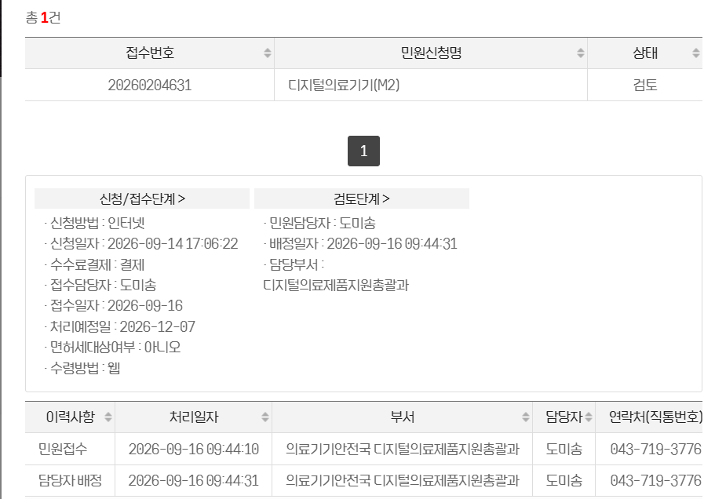
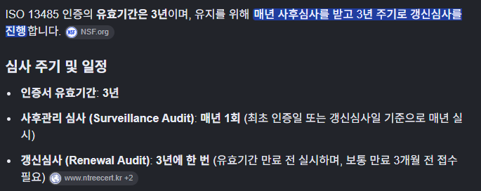

# 10월 29일 보고 내용

---

## 1. M2 얼리부스트: 사전검토 상황

---

## 2. ISO 13485 심사 관련

### 2-1. 심사 주기

ISO 13485 인증의 유효기간은 3년이며, 유지하려면 매년 사후심사를 받고 3년마다 갱신심사를 받아야 함.

*ISO 13485 심사 주기 및 일정*

> **현재 상황:** 사후심사 준비 중

### 2-2. 사후심사 준비 내용

1. 품질절차서 내용 수정
2. 품질절차서 관련 양식 확보 및 작성
